<div align="center">

# CohereFusion

### Text-Guided Reliability-Aware Infrared and Visible Image Fusion

**Two modalities. One coherent vision.**

  [](https://wang2025-source.github.io/CohereFusion/)

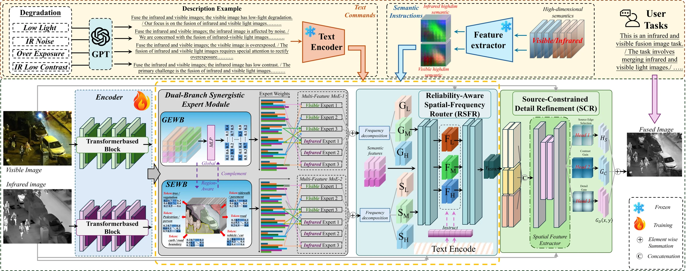

</div>

## ⚙️ 1. Create Environment

The recommended environment is Python 3.12, PyTorch 2.5.1 and torchvision 0.20.1 with CUDA 12.4. Install a compatible PyTorch/torchvision pair for your machine, then:

```bash
git clone https://github.com/wang2025-source/CohereFusion.git
cd CohereFusion
pip install -r requirements.txt
```

## 📦 2. Prepare Your Dataset

Use registered infrared/visible EMS pairs and replace the example dataset root with your actual location. The current loader recognizes four degradation tasks: `Low_light`, `Over_exposure`, `IR_Low_contrast`, and `IR_Noise`.

```text
EMS_lite_with_text/
├── Low_light/
│   ├── train/
│   │   ├── Visible/
│   │   ├── Infrared/
│   │   ├── Visible_gt/
│   │   ├── Infrared_gt/
│   │   └── text.txt          # optional
│   └── test/
│       ├── Visible/
│       ├── Infrared/
│       ├── Visible_gt/
│       └── Infrared_gt/
├── Over_exposure/           # same layout
├── IR_Low_contrast/         # same layout
└── IR_Noise/                # same layout
```

Inference supports task descriptions, a custom `--prompt`, or per-image descriptions through `--text-file`.

## 🖥️ 3. Testing and Evaluation

```bash
# Inference on paired EMS inputs; replace the dataset path.
python launch.py infer --dataset-root /path/to/EMS_lite_with_text --weights /path/to/coherefusion.pth --output outputs/coherefusion

# Evaluate existing fused outputs.
python launch.py evaluate --source /path/to/EMS_lite_with_text --fused outputs/coherefusion --output outputs/metrics.json --workers 4 --clean-reference

```

## 🚀 4. Train

Use the training configuration and an explicit scene-disjoint split manifest.

```bash
python launch.py train --config configs/train.json --dataset-root /path/to/EMS_lite_with_text --output-dir ./new_runs --run-name coherefusion_new --split-manifest /path/to/splits.json
```

## 📊 5. Evaluation Results

Cross-dataset results (Table III). **Best**, *second best*.

### MSRS

| Method | Venue/Year | EN ↑ | SD ↑ | SF ↑ | AG ↑ | SCD ↑ | VIF ↑ |
|:--|:--|---:|---:|---:|---:|---:|---:|
| *Without text input* | | | | | | | |
| U2Fusion | TPAMI 2022 | 6.500 | 42.650 | 10.620 | 3.200 | 1.290 | 1.000 |
| TarDAL | CVPR 2022 | 6.340 | 35.460 | 9.870 | 3.110 | 1.480 | 0.670 |
| DDFM | ICCV 2023 | 6.401 | 36.470 | 10.920 | 3.570 | 1.410 | 0.901 |
| SHIP | CVPR 2024 | 6.716 | 44.280 | 13.210 | 4.180 | 1.681 | 1.012 |
| TEDFusion | ICML 2026 | 6.740 | 42.900 | 12.220 | 4.120 | 1.660 | 0.954 |
| *With text input* | | | | | | | |
| TextFusion | Inf. Fusion 2025 | 6.230 | 40.850 | 10.320 | 3.040 | 1.560 | 0.892 |
| Text-IF | CVPR 2024 | 6.720 | 44.030 | 11.630 | 3.840 | 1.650 | *1.046* |
| GSU-Fusion | Inf. Fusion 2026 | 6.700 | 45.710 | 13.880 | 4.500 | 1.740 | 1.000 |
| TSANet | TIP 2025 | 6.781 | 45.360 | 13.570 | 4.390 | 1.723 | 1.021 |
| GText-IF | TPAMI 2026 | *6.903* | *46.420* | *14.160* | *4.570* | *1.754* | **1.052** |
| **CohereFusion** | -- | **6.972** | **47.310** | **14.760** | **4.710** | **1.792** | 1.041 |

### RoadScene

| Method | Venue/Year | EN ↑ | SD ↑ | SF ↑ | AG ↑ | SCD ↑ | VIF ↑ |
|:--|:--|---:|---:|---:|---:|---:|---:|
| *Without text input* | | | | | | | |
| U2Fusion | TPAMI 2022 | 6.840 | 32.660 | 7.540 | 3.280 | 1.380 | 0.741 |
| TarDAL | CVPR 2022 | 6.980 | 40.720 | 6.440 | 2.690 | 1.580 | 0.762 |
| DDFM | ICCV 2023 | 7.112 | 45.370 | 9.630 | 3.890 | 1.590 | 0.821 |
| SHIP | CVPR 2024 | 7.181 | 47.620 | 11.420 | 4.370 | 1.681 | 0.873 |
| TEDFusion | ICML 2026 | 7.070 | **60.850** | 13.880 | 4.790 | 1.750 | 0.908 |
| *With text input* | | | | | | | |
| TextFusion | Inf. Fusion 2025 | 6.980 | 40.490 | 6.700 | 2.640 | 1.530 | 0.834 |
| Text-IF | CVPR 2024 | 7.310 | 46.700 | 10.390 | 4.420 | 1.480 | 0.902 |
| GSU-Fusion | Inf. Fusion 2026 | 7.284 | 49.520 | 12.960 | 4.610 | 1.710 | 0.915 |
| TSANet | TIP 2025 | 7.321 | 52.480 | 13.750 | 4.720 | 1.771 | 0.934 |
| GText-IF | TPAMI 2026 | *7.352* | 56.730 | *14.170* | *4.910* | *1.793* | **0.972** |
| **CohereFusion** | -- | **7.418** | *59.960* | **14.530** | **5.030** | **1.824** | *0.961* |

### LLVIP

| Method | Venue/Year | EN ↑ | SD ↑ | SF ↑ | AG ↑ | SCD ↑ | VIF ↑ |
|:--|:--|---:|---:|---:|---:|---:|---:|
| *Without text input* | | | | | | | |
| U2Fusion | TPAMI 2022 | 6.580 | 33.470 | 11.300 | 3.460 | 1.330 | 0.702 |
| TarDAL | CVPR 2022 | 7.290 | **50.140** | 13.320 | 3.560 | 1.330 | 0.630 |
| DDFM | ICCV 2023 | 7.118 | 43.680 | 13.940 | 4.050 | 1.410 | 0.751 |
| SHIP | CVPR 2024 | 7.244 | 46.763 | 15.180 | 4.620 | 1.562 | 0.821 |
| TEDFusion | ICML 2026 | 7.360 | 48.750 | 15.700 | 4.830 | 1.690 | 0.891 |
| *With text input* | | | | | | | |
| TextFusion | Inf. Fusion 2025 | 6.650 | 37.300 | 11.220 | 3.120 | 1.220 | 0.781 |
| Text-IF | CVPR 2024 | 7.240 | 45.380 | 16.290 | 4.810 | 1.460 | 0.884 |
| GSU-Fusion | Inf. Fusion 2026 | 7.290 | 48.430 | 17.340 | 4.940 | 1.560 | 0.880 |
| TSANet | TIP 2025 | 7.347 | 48.920 | 17.160 | 4.960 | 1.671 | 0.902 |
| GText-IF | TPAMI 2026 | *7.391* | 49.180 | *17.570* | *5.030* | *1.704* | **0.936** |
| **CohereFusion** | -- | **7.436** | *50.120* | **17.890** | **5.130** | **1.742** | *0.921* |

## 🖼️ 6. Visual Results

### Architecture and modules

**Fusion paradigms under degradation**

[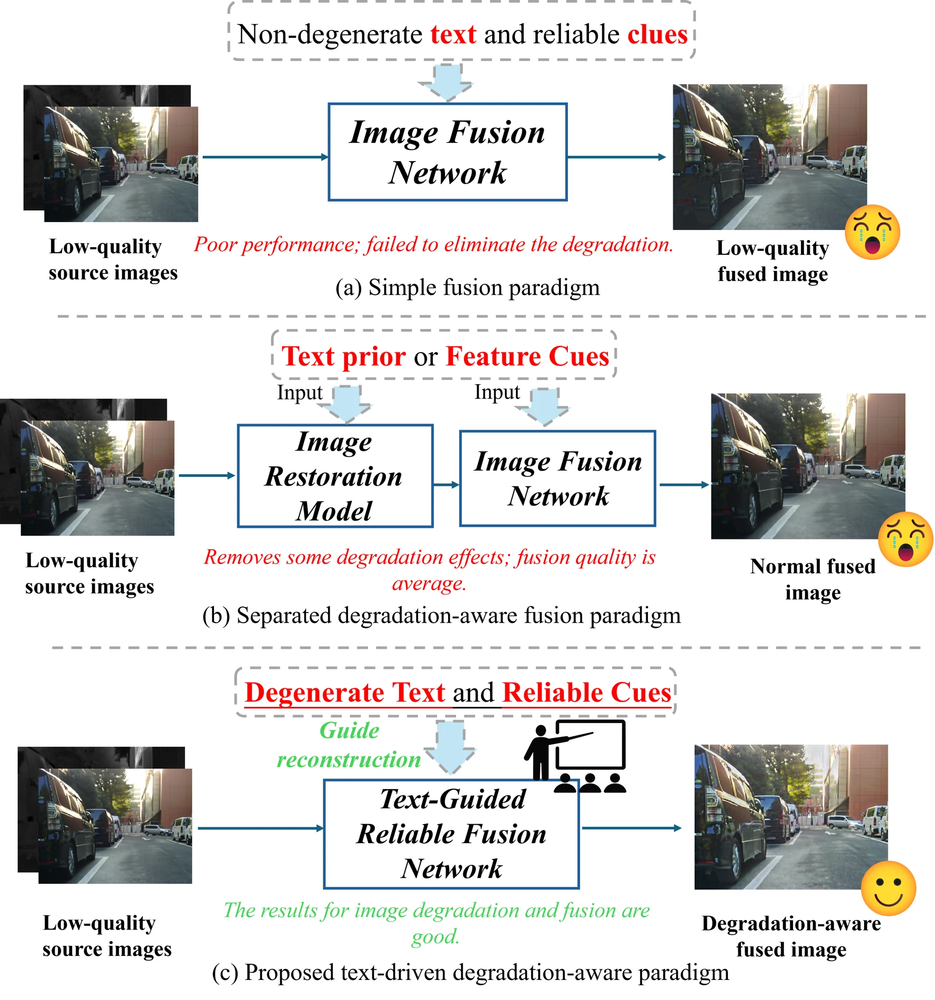](figures/figure-12.png)

**Overall architecture**

[](figures/figure-03.png)

**Global and semantic expert branches**

[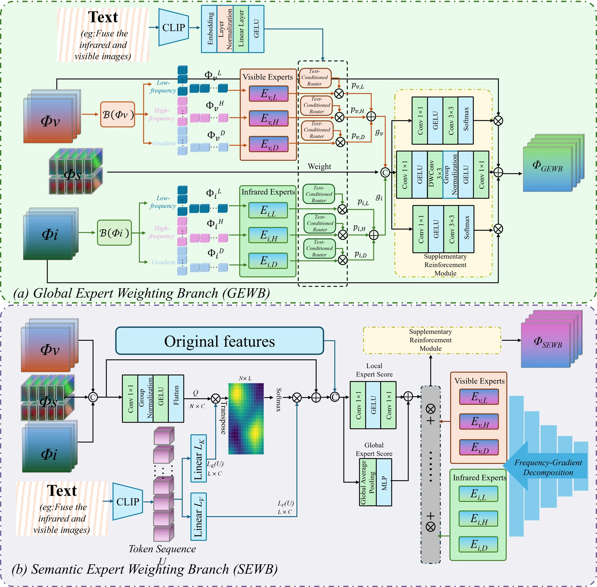](figures/figure-04.png)

**Reliability-aware routing and source-constrained refinement**

[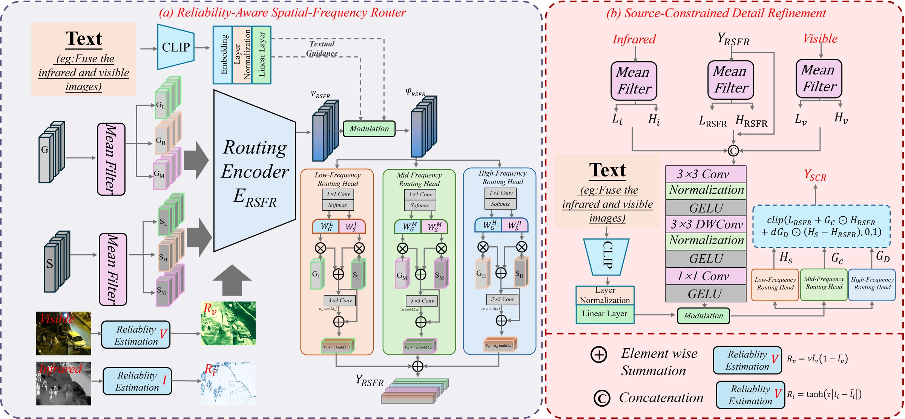](figures/figure-05.png)

### Fusion comparisons

**Fusion under four degradation scenarios**

[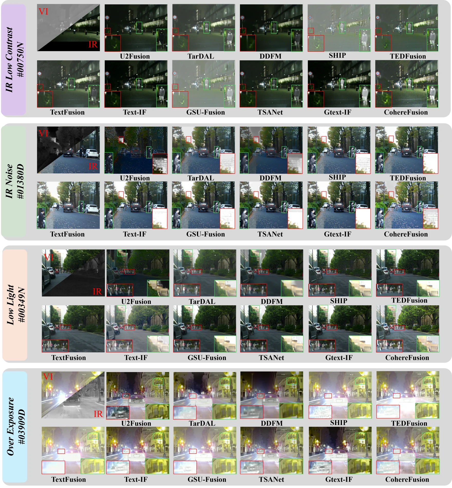](figures/figure-06.png)

**Cross-dataset fusion comparisons**

[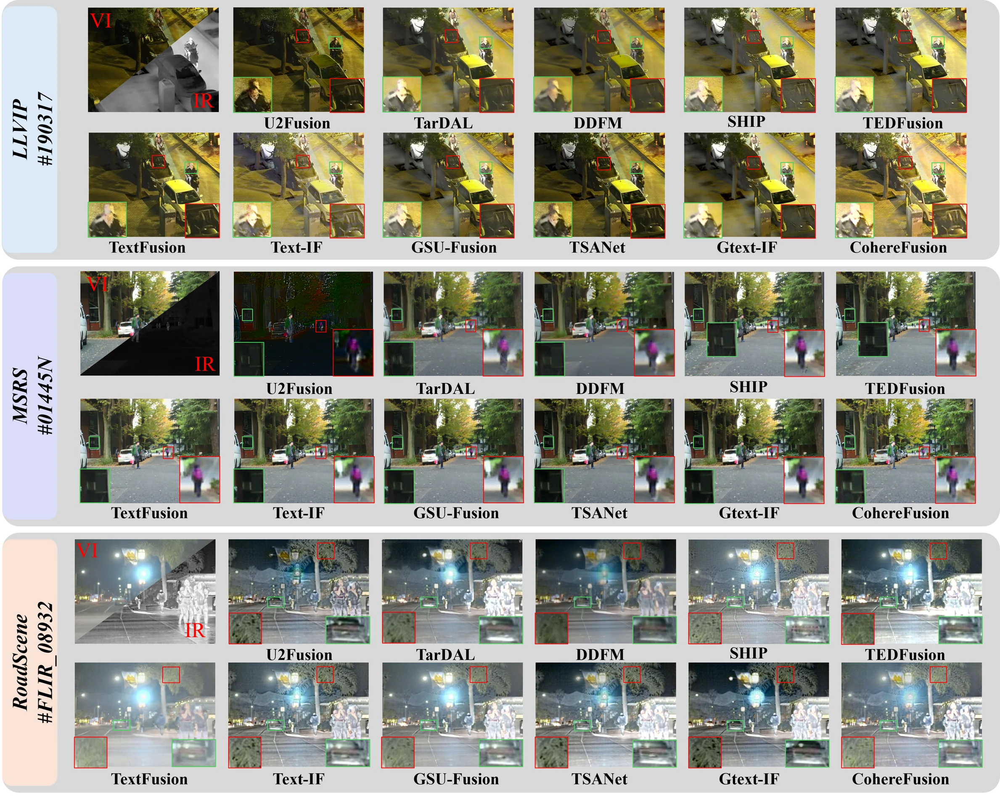](figures/figure-07.png)

### Ablation and downstream results

**Text ablation · infrared noise**

[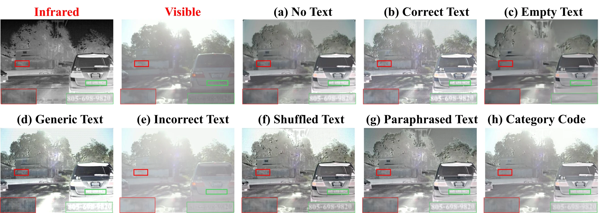](figures/figure-08.png)

**Text ablation · visible overexposure**

[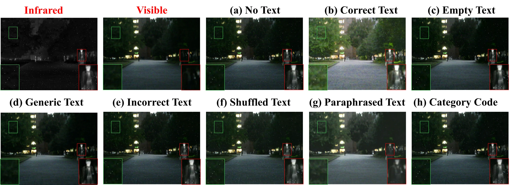](figures/figure-09.png)

**Component ablation · visible low light**

[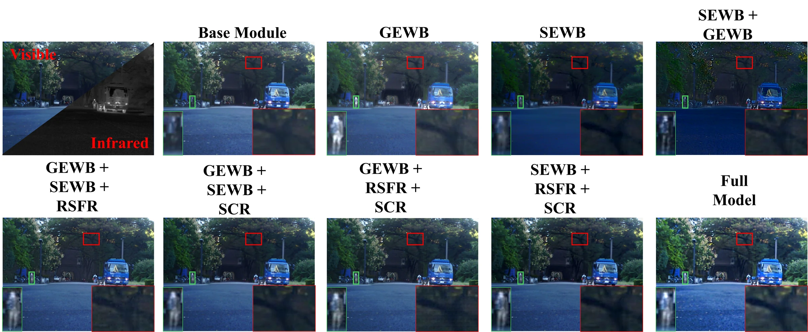](figures/figure-10.png)

**Component ablation · infrared low contrast**

[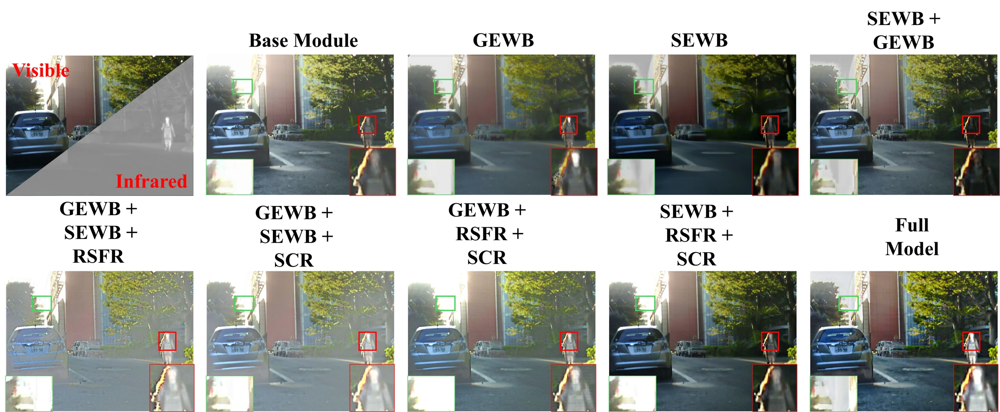](figures/figure-11.png)

**Object detection comparisons on M3FD**

[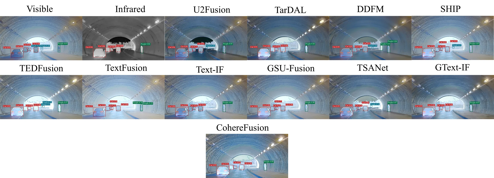](figures/figure-13.png)

**Semantic segmentation comparisons on MSRS**

[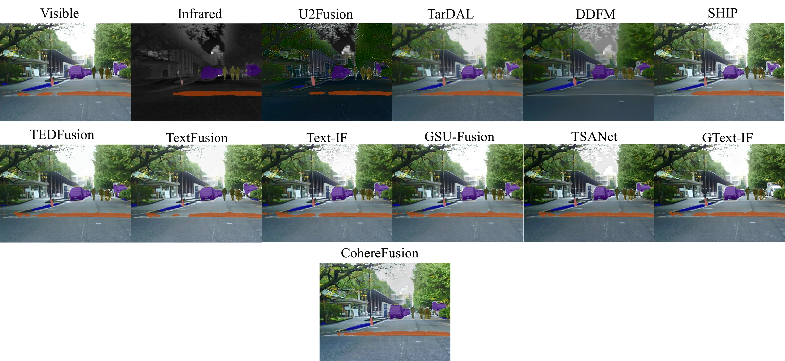](figures/figure-14.png)

## 🗂️ Repository Structure

```text
model/          CohereFusion and shared network blocks
data/           Registered image pairs and text descriptions
scripts/        Loss functions and checkpoint utilities
configs/        Training configuration
clip/           CLIP text-encoder support
train.py        Training
infer.py        Inference
evaluate.py     Evaluation
launch.py       Command entry point
```
